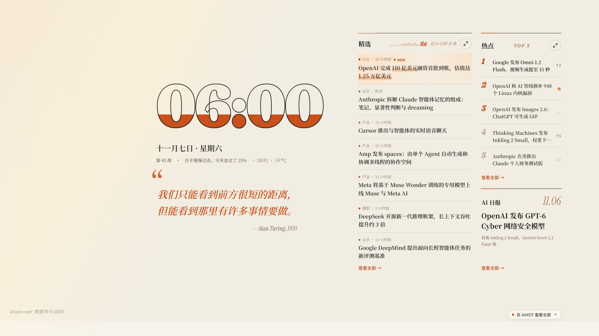
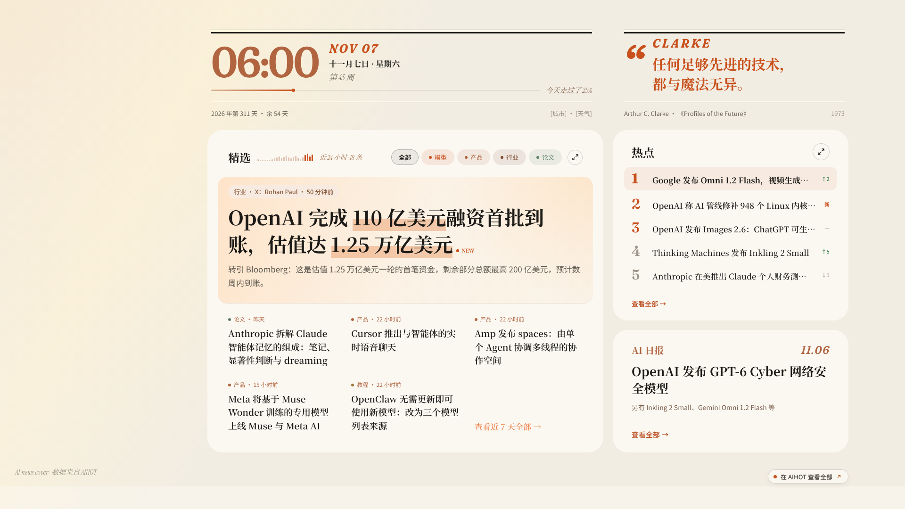

# AI news cover 体验指南

一张会自己更新的 AI 报纸，铺在你的桌面上。三分钟装好，剩下的慢慢发现。

## 先看一眼

打开 [这个链接](https://liljay-h.github.io/ai-news-cover/) 就能看，和桌面上的是同一张报纸。

## 三分钟装好

想装到桌面，点页面右下角的「装到桌面」。它会认出你的系统，只给你需要的那一步。

### Windows

1. 点「下载并双击」，下载 `AI-news-cover-Setup.exe`
2. 双击运行。如果提示「Windows 已保护你的电脑」，点「更多信息」，再点「仍要运行」
3. 桌面上就是报纸了，不需要装别的软件

已经在用 Lively 或 Wallpaper Engine？右键托盘里的小图标，在「更多」里选「导入到 Lively / Wallpaper Engine」，这一步可选。

### Mac

1. 先装免费的 [Plash](https://apps.apple.com/app/id1494023538)
2. 回到页面，点「装到桌面」里的「添加到 Plash」
3. 在菜单栏的 Plash 里打开「浏览模式」，就能点新闻；在设置里打开「在默认浏览器中打开外部链接」，点开的新闻会在浏览器里弹出

### 装成一个小应用

在 Chrome 或 Edge 里，「装到桌面」的卡片下面有「安装为应用」，点一下就装成一个独立的小窗口。Mac 上的 Safari：菜单「文件 → 添加到程序坞」。

想开机自动打开它：
- **Edge**：地址栏输入 `edge://apps`，在「AI news cover」右边的「…」里勾选「登录时自动启动」
- **Chrome**：地址栏输入 `chrome://apps`，右键「AI news cover」，进「应用设置」，打开「登录时启动」

### 让 AI 助手帮你装

对它说：「按这个链接帮我装：https://liljay-h.github.io/ai-news-cover/install.md」

## 两种读法

右下角有两个小图标，点一下就能换。

- **简约版**：像一张印好的报纸，安静地铺在桌面上
- **详细版**：精选、热点、日报各一张卡片，想多看一点的时候用它

屏幕小的时候，它会自己换成简约版。

## 一眼、展开、细读

- 平时，抬眼看一下标题就够了
- 想多看，点栏头的放大按钮，这一栏会在原地铺开；精选和热点之间，点另一边的放大按钮就能直接换过去
- 对哪条感兴趣，点它，读摘要和推荐理由
- 想读全文，点「在 AIHOT 阅读原文」，浏览器会帮你打开
- 点日报，可以读完整的一期

全程只用鼠标。

## 按你的喜好调一调

右键屏幕右下角托盘里的小图标，可以换：

- **预设**：简约版，或详细版
- **外观**：跟随系统、浅色、深色
- **更多**：开机启动（开机后自动铺好报纸）、导入到 Lively / Wallpaper Engine、卸载
- **退出**：暂时不要桌面上的报纸

用 Lively 或 Wallpaper Engine 的，照旧在它们的属性里改，那里还能换强调色。

## 藏在纸里的东西

不剧透。留意清晨、深夜、你离开之后，还有日报右上角的那个小角。

## 遇到问题

到 [Issues](https://github.com/LilJay-H/ai-news-cover/issues) 告诉我，我会看的。
